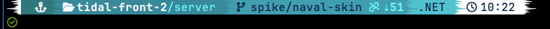
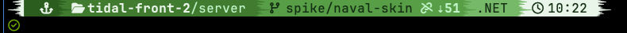
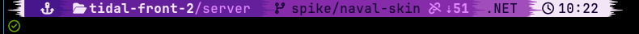
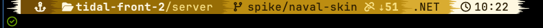
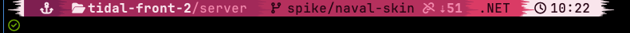
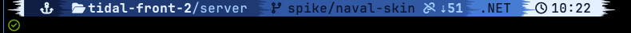
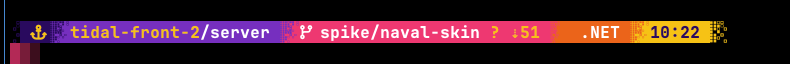
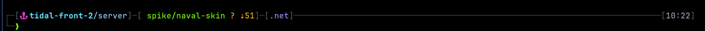
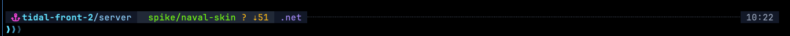

# starship-themes

Powerline prompts for [Starship](https://starship.rs), plus matching status lines for
Claude Code. All of them need a [Nerd Font](https://www.nerdfonts.com/); they were built
and checked against Hack Nerd Font v3.

## Themes

Six palettes share one layout, derived from the Viking theme in
[tr3ss/starship-themes](https://github.com/tr3ss/starship-themes): ice-shaped separators,
a project badge, a repo-aware directory, git branch, status, rebase/merge state and line
metrics, runtime badges, the clock, and the prompt character on its own line.

| Theme | Ramp | |
|---|---|---|
| `viking` | teal, the original palette |  |
| `druid` | forest green to mint |  |
| `mage` | deep violet to lavender |  |
| `gilt` | bronze to gold |  |
| `ember` | wine to rose |  |
| `naval` | dark navy to sky |  |

Three more are their own layouts:

**arcade** — 8-bit powerline: pixel stair-step separators, synthwave gradient, `▓▒░` cursor



**neon** — thin box-drawing frame, neon text, rail across to the clock



**hud** — dark glass panels with slanted edges, neon readouts, fading chevron cursor



## Install

```sh
mkdir -p ~/.config
cp themes/mage.toml ~/.config/starship.toml
```

Or keep them all and point Starship at one:

```sh
cp themes/*.toml ~/.config/
export STARSHIP_CONFIG=~/.config/arcade.toml
```

### One theme per directory

Starship re-reads `STARSHIP_CONFIG` on every prompt, so a `chpwd` hook can switch themes
as you `cd`. `zsh-theme-per-directory.zsh` is the hook; it expects the themes at
`~/.config/starship-<name>.toml`. Edit the `case` table, then source it from `~/.zshrc`.

```sh
for f in themes/*.toml; do cp "$f" ~/.config/starship-$(basename "$f"); done
cat zsh-theme-per-directory.zsh >> ~/.zshrc
```

### Project badge

Every theme has a `[custom.project]` module at the bottom that prints a glyph per project
by matching the current path, with the Apple logo as the fallback. Add a line to its
`case` block for each of your projects.

## Claude Code status line

`claude-code/statusline.sh` draws the same bar in Claude Code's status line and takes its
colours from the Starship theme in use, so the prompt and the status line always match.
It reads `STARSHIP_CONFIG`, which Claude Code inherits from the shell it was started in,
and falls back to `~/.config/starship.toml`. With the per-directory hook above, each
project gets its palette in Claude Code too. The badge, directory, git, runtime and clock
colours come from the matching Starship sections; a theme without backgrounds, like
`neon`, falls back to the druid greens.

Install it and point `~/.claude/settings.json` at it:

```sh
cp claude-code/statusline.sh ~/.claude/statusline-command.sh
```

```json
"statusLine": {
  "type": "command",
  "command": "bash /Users/you/.claude/statusline-command.sh"
}
```

It needs `jq`.

## Pull requests

Not accepted. This is a personal config, published so it is easy to copy. Fork it and
make it yours; pull requests are closed automatically.

## Credits

Layout and the Viking palette from [tr3ss/starship-themes](https://github.com/tr3ss/starship-themes).
